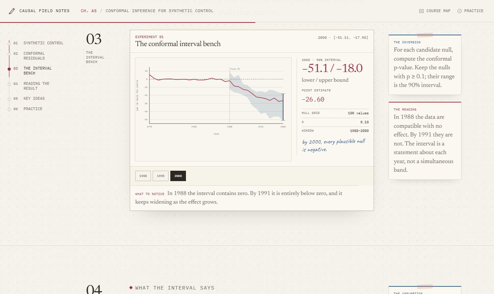

# Causal Field Notes

An interactive field guide to the whole of
[*Causal Inference for the Brave and True*](https://matheusfacure.github.io/python-causality-handbook/landing-page.html):
25 chapters and 5 technical notes, rebuilt as stories you can read, labs you can break,
and arguments you can defend.

**Live:** <https://ghcharleslau.github.io/causal-lab/>
**Repository:** <https://github.com/GHCharlesLau/causal-lab>

**Status:** 30 of 30 pages live. Every page combines a short story, an interactive lab, a
readable formula, a defense, and a link to the source chapter. The site is static: no
backend, no build step, and no tracking.

## What's inside

- **Part I — Identification (01–16):** potential outcomes, experiments, graphs, regression,
  instruments, matching, propensity scores, DiD, panel data, synthetic control, and RD.
- **Part II — Heterogeneity (17–25):** prediction versus policy, CATEs, evaluating causal
  models, plug-and-play estimators, meta-learners, orthogonal ML, and the DiD saga.
- **Appendix (A1–A5):** orthogonalization, propensity-score debiasing, prediction failure,
  prediction metrics, and conformal inference for synthetic control.
- **Matching** also includes an eight-question quiz, a Python mirror, a checklist, and a
  downloadable practice notebook.

## A look inside




## Run and deploy

Open `index.html` directly, or serve the folder locally:

```bash
python -m http.server 4173 --bind 127.0.0.1
```

Then visit <http://127.0.0.1:4173/>.

To deploy, copy the whole folder to any static host. Keep `index.html` at the root and
ship `chapters/` and `assets/` with it; all internal links are relative. This repository
deploys from the `main` branch root through GitHub Pages, with `.nojekyll` so GitHub
serves the files directly. The video is optional: without
`assets/video/matching-opener.mp4`, the Matching page falls back gracefully.

## Accuracy

Each page is built against `reference/chapter-briefs/<slug>.md`, then checked with a Node
arithmetic test and a browser interaction test before it is marked live. The Matching page,
for example, reproduces the book's naive **+16.90**, 1-NN **−0.9954**, and bias-corrected
**−7.3627** estimates. The medicine simulation's known **−10-day** effect is shown as a
labelled teaching device, not as the book's reported estimate.

All 30 pages were audited at desktop and mobile widths, and over `file://`; the suite has
**139 passing tests**. Fonts, data, and images are local.

```bash
node --test tests/*.test.mjs
node tools/check-paths.mjs
node tools/cdp-audit.mjs "https://ghcharleslau.github.io/causal-lab/chapters/" 1440 900
```

The browser checks use Chrome DevTools Protocol through Node's built-in WebSocket, with no
Playwright or Puppeteer dependency. The `tools/` folder also contains the individual chapter
CDP checks, accessibility checks, and reduced-motion checks.

## Data and provenance

Most data lives in `assets/js/data*.js` or `data/`, generated from the book's CSVs and its
seeded simulations. The numbers on the pages are recomputed rather than copied; source links
and data notes are on each page. Third-party licenses and attribution are collected in
[THIRD_PARTY_NOTICES.md](THIRD_PARTY_NOTICES.md).

## Accessibility and limitations

- Local fonts, visible focus states, labelled controls, and reduced-motion handling.
- No analytics, cookies, backend, or external asset requests.
- Wide charts and tables scroll horizontally on small screens; the code mirror does too.
- This is an independent learning adaptation, not affiliated with the book's author.
  Mistakes and interface choices are ours; the source text and data are MIT-licensed.

## Credits

- **Book and data:** Matheus Facure Alves, *Causal Inference for the Brave and True* (MIT).
- **Visual language:** adapted from the Data Storytelling style in *Lemo-Opuscar* by Lemomo
  (MIT).
- **Opener:** built with HyperFrames (Apache 2.0).
- **Type:** Newsreader, IBM Plex Mono, and Caveat, under the SIL Open Font License.
