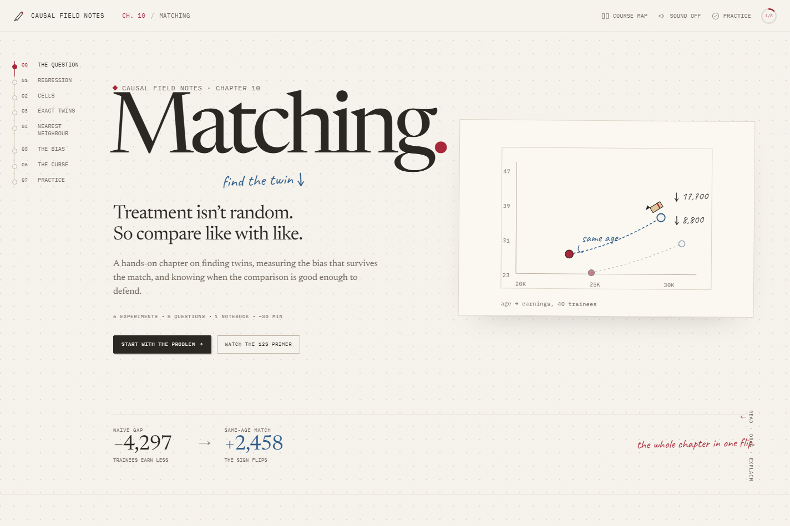
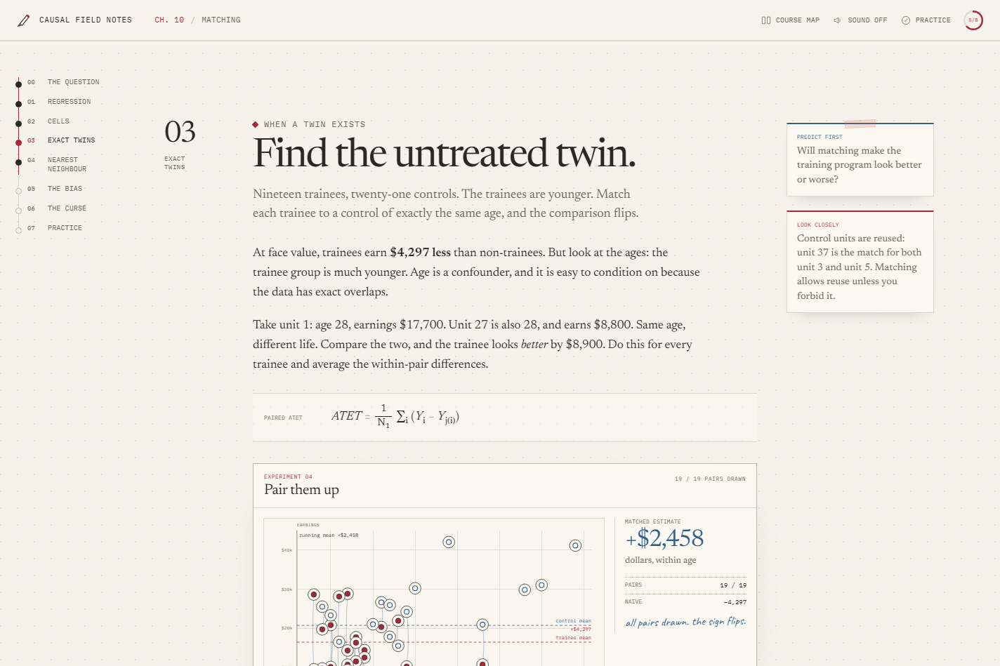
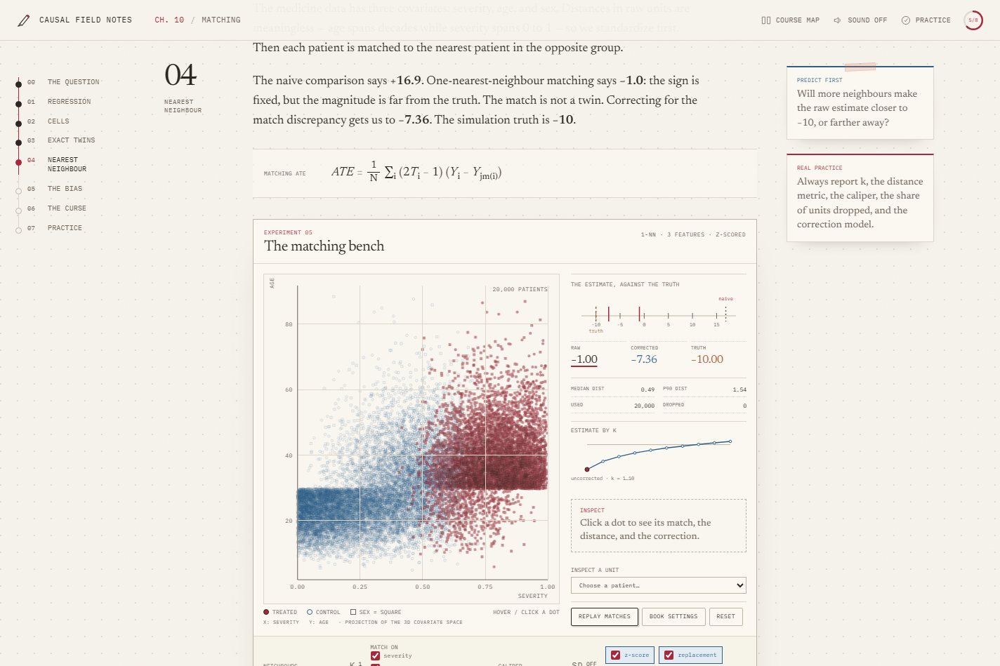

# Matching Lab

An interactive chapter on **matching** for causal inference, built around Chapter 10 of
[*Causal Inference for the Brave and True*](https://matheusfacure.github.io/python-causality-handbook/10-Matching.html).

It is a local, dependency-free web page: no backend, no build step, no tracking. Open
`index.html` directly, or serve the folder over HTTP.

---

## What is in it

- **Seven sections** that follow the chapter: the confounding problem, regression as a
  weighted average, cells/subclassification, exact matching, nearest-neighbour matching,
  matching bias, and the curse of dimensionality.
- **Six interactive experiments** plus a cell atlas:
  - a severity-band sweep on 20,000 patients;
  - a balance-scale view of regression weights;
  - an exact-age pair-up on 40 trainees, with tie-breaking;
  - a full k-NN matching bench (features, scaling, k, caliper, replacement, bias correction);
  - a pair-level bias microscope with the chapter's correction terms;
  - a dimensionality lab showing how nearest-neighbour distance grows.
- **A mastery section:** 8 questions with explanations, a Python code mirror that follows
  your lab settings, a field-ready checklist, and a self-contained practice notebook.
- **Motion:** a small seekable timeline engine drives pencil-drawn charts, dot landings,
  match-line reveals, a tilting scale, a moving estimate ruler, and a growing
  nearest-neighbour curve. All animations respect `prefers-reduced-motion`.
- **A 12-second opener** authored as a HyperFrames composition and rendered to MP4.
  The page works without it; the composition and render instructions live in `motion/`.

### The numbers

The page reproduces the book's values:

| Check | Value |
|---|---|
| Medicine, naive | +16.90 |
| Medicine, 1-NN matching | −0.9954 |
| Medicine, bias-corrected | −7.3627 |
| Trainees, naive | −4,297.49 |
| Trainees, exact match on age | +2,457.89 |
| Drug example, naive / cells / OLS | −1.1905 / −2.6000 / −2.4545 |

The medicine data is simulated in the book's companion notebook with a **constant −10-day
treatment effect**. The page uses that as a labelled "truth" line and includes an oracle
outcome model benchmark (about −10.05). The book's chapter does not reveal the truth; the
point here is to let you see estimator bias separately from confounding bias.

---

## A look inside







---

## Quick start

### Option 1: double-click

Open `index.html` in Chrome or Edge. Everything needed is local: CSS, JS, data, fonts,
the poster, and the rendered opener at `assets/video/matching-opener.mp4`.

### Option 2: local server

From this folder:

```bash
python -m http.server 4173 --bind 127.0.0.1
```

Then open <http://127.0.0.1:4173/>.

On this machine the bundled runtimes are at:

```text
C:\Users\liuyu\.dsh\dsh-runtimes\dsh-primary-runtime\dependencies\python\python.exe
C:\Users\liuyu\.dsh\dsh-runtimes\dsh-primary-runtime\dependencies\node\bin\node.exe
```

---

## Controls

- **Top bar:** course map, sound (off by default), practice mode, progress.
- **Practice mode** hides the guided hints, the truth line, and the benchmark note. Use it
  for a cold attempt, then turn it off to check your reasoning.
- **Every lab** has a "what to notice" caption and a predict-first prompt.
- **KNN bench:** hover a dot for a tooltip, click to pin it, or use the **Inspect a unit**
  dropdown for keyboard access. The select lists a sample of treated and control patients.
- **Exact matching:** press **Play pairs**, drag the scrubber, click a dot, or **Shuffle ties**.
- **Keyboard:** all sliders, switches, buttons, and dialogs are keyboard operable. Use
  Tab/Shift+Tab and arrow keys on sliders.

---

## Data

| File | Rows | Source |
|---|---|---|
| `data/medicine_impact_recovery.csv` | 20,000 | Book repository, simulated with `np.random.seed(1234)` |
| `data/trainees.csv` | 40 | Book repository, contrived chapter example |
| `data/drug_example.csv` | 10 | The chapter's six-men/four-women toy table |

Columns for the medicine data: `sex`, `age`, `severity`, `medication`, `recovery`.
6,924 of the 20,000 patients are treated. The companion notebook
[`Simulated-Data.ipynb`](https://github.com/matheusfacure/python-causality-handbook/blob/master/Simulated-Data.ipynb)
sets the recovery function so the treatment effect is exactly −10 days.

`tools/build-data.py` reads the CSVs and regenerates:

- `assets/js/data.js` — the embedded typed-array payload;
- `assets/js/reference.js` — book numbers, k-curve, severity-band checkpoints, oracle;
- `data/drug_example.csv`.

Run it with the bundled Python:

```powershell
& "C:\Users\liuyu\.dsh\dsh-runtimes\dsh-primary-runtime\dependencies\python\python.exe" tools/build-data.py
```

It takes about 20–30 seconds because it computes the exact 20,000 × 20,000 nearest
neighbours for the reference values.

---

## Tests

Reference and stats tests (Node 24, no packages):

```powershell
& "C:\Users\liuyu\.dsh\dsh-runtimes\dsh-primary-runtime\dependencies\node\bin\node.exe" --test tests/reference.test.mjs
```

The suite checks the book numbers, the k-curve, the severity-band checkpoints, the oracle,
the k-d tree against brute force, and the OLS toy regression.

Browser smoke tests use Chrome DevTools Protocol through Node's built-in WebSocket (no
Playwright/Puppeteer):

```powershell
& "...\node.exe" tools/cdp-smoke.mjs
& "...\node.exe" tools/cdp-interact.mjs
& "...\node.exe" tools/cdp-a11y.mjs
& "...\node.exe" tools/cdp-reduced.mjs
& "...\node.exe" tools/cdp-film.mjs
& "...\node.exe" tools/cdp-persist.mjs
& "...\node.exe" tools/cdp-review.mjs   # writes screenshots to assets/img/_shots
```

`cdp-interact.mjs` drives the band, regression, exact-match play, k, bias correction,
omitting sex, unit inspection, bias cycling, the dimension slider, the quiz, the checklist,
practice mode, and the course map. It prints the observed values and any console errors.
`cdp-a11y.mjs` checks button names, input labels, duplicate IDs, and heading structure;
`cdp-reduced.mjs` verifies that reduced motion lands on final states; `cdp-film.mjs`
checks the rendered video’s metadata and dialog; `cdp-persist.mjs` reloads after scoring
the quiz and completing the checklist to verify localStorage restoration.

---

## Architecture

```
index.html                 the chapter, semantic markup and lab shells
assets/css/
  tokens.css               paper/ink/pencil tokens, type scale
  base.css                 reset, type, focus, grain, toast
  layout.css               top bar, rail, hero, sections, footer, breakpoints
  components.css           buttons, labs, tables, quiz, dialogs, checklist, print hooks
  charts.css               SVG chart grammar, ruler, sparkline, waterfall, cell atlas
  print.css                readable paper version
assets/js/
  data.js                  generated typed-array payload (20k patients)
  reference.js             generated book numbers
  stats.js                 mean/sd/OLS, k-d tree, k-NN matching, correction, helpers
  timeline.js              seekable rAF timeline + reduced motion + visibility
  pencil.js                jittered paths, write-on, tip tracking
  charts.js                SVG scales, ticks, markers, formatting
  sound.js                 optional WebAudio plucks/ticks
  progress.js              localStorage state (visited, quiz, checklist, settings)
  quiz.js                  8 questions + explanations
  scenes/*.js              one module per experiment
  app.js                   shell, dialogs, scrollspy, quiz/checklist/code wiring
data/                      source CSVs
practice/                  self-contained notebook
motion/                    HyperFrames composition + render output
tools/                     data build, notebook build, CDP smoke/screenshot scripts
tests/                     Node reference tests
```

The page uses classic `<script defer>` files and one global namespace (`window.MatchLab`).
No fetch at runtime, no module/CORS requirements, so `file://` works. `stats.js` and
`data.js` also export to `module.exports` so Node tests can load them.

### Stats engine

`stats.matching(data, {features, k, standardize, caliper, replace})` builds two k-d trees,
finds the 10 nearest opposite-group neighbours for every unit, applies an optional caliper,
and computes:

- raw ATE/ATT/ATC with the book's signed formula;
- bias-corrected ATE/ATT/ATC by fitting `mu0` on the untreated and `mu1` on the treated;
- the k=1..10 curve, nearest-match distance quantiles, per-unit matches, and dropped counts.

Changing `k` reuses the precomputed matches (`result.estimateAt`), so the slider stays
responsive. Changing features, scaling, replacement, or caliper rebuilds the trees.

---

## Extending the chapter series

The shell is intentionally reusable. A new chapter needs:

1. a section in `index.html` with `data-section` and the same `section-grid` structure;
2. a scene module under `assets/js/scenes/` that registers itself on `window.MatchLabScenes`;
3. a dataset and a generated `data.js` payload (or a small inline one);
4. a practice notebook built with `tools/build-notebook.py` (copy and adapt);
5. a course-map ticket in `app.js`.

Chapters 11–16 are shown as planned in the course map. The next one is the propensity
score, which resolves the curse by compressing X into one dimension.

---

## HyperFrames opener

`motion/` contains a 1920×1080, 24 fps, 12-second composition using the same trainee story:
the naive gap, the same-age match lines, and the flip to +2,458. The rendered MP4 is
included at `assets/video/matching-opener.mp4`; the page shows it in the “Watch the 12s
primer” dialog with a poster and transcript.

To re-render:

```powershell
cd motion
pnpm install
npm run render
```

`npm run render` writes `../assets/video/matching-opener.mp4` and takes about 25 seconds on
this machine. See `motion/README.md` for the check results and composition notes.

The page looks for `assets/video/matching-opener.mp4`. If the file is absent, the film
dialog shows a fallback note and the rest of the chapter is unaffected. The composition
source is still valid and can be rendered later.

---

## Accessibility, performance, and limitations

- Semantic headings, skip link, visible focus, native dialogs, `aria-live` estimate updates,
  colour + shape encoding, figcaption summaries, and a keyboard-accessible unit dropdown.
- `prefers-reduced-motion` jumps timelines to their final state; no autoplay.
- The 20,000-point cloud is drawn on Canvas from a cached offscreen layer; the k-d tree is
  rebuilt only when the matching design changes. Estimates use all 20,000 rows.
- Mobile SVG charts below 720 px keep a 600 px wide drawing and scroll horizontally inside
  their card, so labels stay legible instead of shrinking to 4 px. A “swipe →” hint marks
  the cards that scroll.
- English-only in this version.
- The medicine data is simulated; the truth line is a teaching device.
- The page is an independent learning demo, not affiliated with the book's author, Lemomo,
  or HeyGen.
- Matching estimates are design-dependent. The page shows the design choices; it does not
  claim to produce production-ready effect estimates.

---

## Credits

- **Book & data:** Matheus Facure Alves, *Causal Inference for the Brave and True*,
  Chapter 10, MIT-licensed repository.
- **Visual language:** adapted from the **Data Storytelling** style in
  [Lemo-Opuscar](https://github.com/lemomo-ai/lemo-opuscar) by Lemomo (MIT). The charts,
  copy, and motion here are original; no demo assets or story are reused.
- **Motion tooling:** [HyperFrames](https://github.com/heygen-com/hyperframes) by HeyGen
  (Apache 2.0) for the optional opener.
- **Type:** Newsreader, IBM Plex Mono, Caveat (SIL Open Font License).

See [`THIRD_PARTY_NOTICES.md`](THIRD_PARTY_NOTICES.md) and
[`assets/fonts/OFL.txt`](assets/fonts/OFL.txt).
